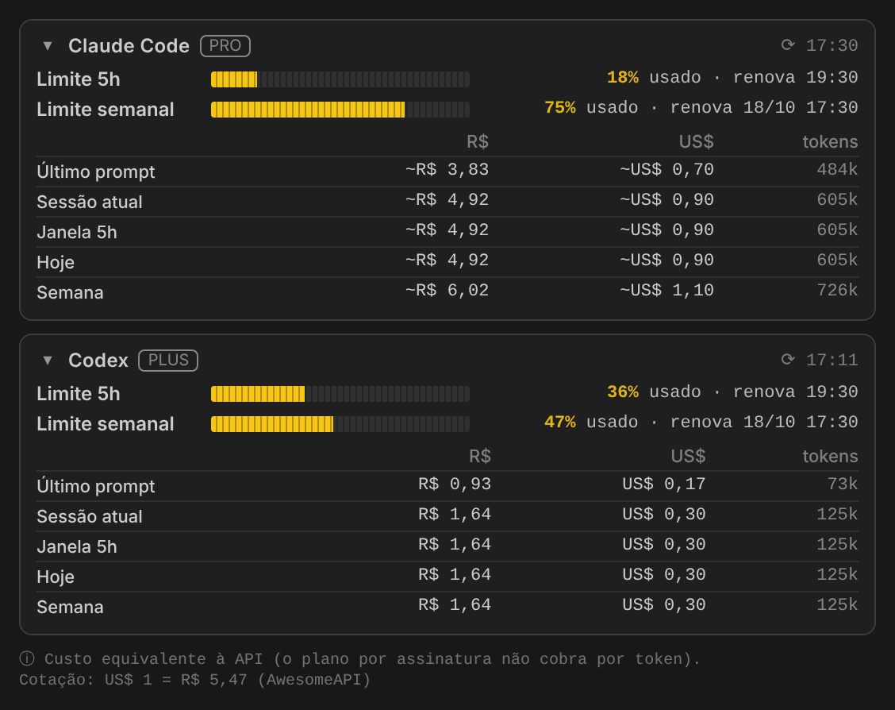

# AI Limits Meter — Claude Code & Codex

**PT-BR** · [English below](#english)

Veja seus limites de **5 horas** e **semanal** do Claude Code e do Codex o tempo todo dentro do VS Code, junto com o consumo em **R$ / US$** e **tokens**, sem precisar abrir a tela de uso.

## O que mostra

- **Barras de limite (5h e semanal)** que começam vazias e enchem até 100%, mostrando quanto já foi usado e quando renova. A barra fica laranja a partir de 80% e vermelha a partir de 92%.
- **Consumo** do último prompt, da sessão atual, da janela de 5h, de hoje e da semana, em R$, US$ e tokens. Passe o mouse em uma linha para ver o detalhe: entrada, saída, cache e número de chamadas.
- **Barra de status** sempre visível, por exemplo `Claude 82%·25%  Codex 64%·53%  R$ 6,56`. Clique nela para abrir o painel.
- **Avisos** quando você atinge 80% e 95% de um limite (configurável).

## De onde vêm os números

| | Claude Code | Codex |
|---|---|---|
| % dos limites | O mesmo endpoint que a tela "Usage" do Claude usa, com o login que o Claude Code já guarda no seu PC | Gravados pelo próprio Codex nos logs de sessão (`~/.codex/sessions`) |
| Tokens e custo | Logs locais (`~/.claude/projects`) | Logs locais (`~/.codex/sessions`) |

- **O custo é o equivalente ao preço da API.** Planos por assinatura (Pro, Max, ChatGPT Plus/Pro) não cobram por token. O valor serve para você ter noção do quanto está consumindo.
- **Cotação US$→R$:** é buscada uma vez por dia em APIs gratuitas (AwesomeAPI, com a ExchangeRate-API como reserva). Se preferir, defina um valor fixo em `aiLimitsMeter.usdToBrl`.
- **Codex:** os limites só são atualizados quando você usa o Codex, porque é nesse momento que ele grava os valores. Depois que uma janela renova, ela volta automaticamente a 100%.
- O endpoint de limites do Claude não é oficialmente documentado e pode mudar.

## Privacidade

- Nada é enviado para terceiros e não há telemetria.
- O token do Claude Code é lido do seu computador e enviado **somente** para `api.anthropic.com`.
- A única outra conexão feita é a consulta da cotação do dólar.

## Instalação

**Pelo Marketplace:** procure por **AI Limits Meter** na aba Extensões.

**Por arquivo `.vsix`:**
1. Abra a aba Extensões.
2. Clique em `⋯` e depois em **Install from VSIX…**.
3. Escolha o arquivo.

**Onde posicionar o painel:** o VS Code não permite que uma extensão se encaixe dentro do chat de outra. Por isso, a faixa não pode ficar acima da caixa de prompt do Claude Code ou do Codex. As opções que funcionam bem são:
- deixar o painel **Limits** na barra lateral esquerda, onde ele já aparece;
- arrastar a aba **Limits** para a barra lateral secundária (direita) ou para o painel inferior, ao lado do chat;
- usar só o resumo da **barra de status**, que fica sempre visível.

O VS Code guarda a posição que você escolher.

## Configurações

| Configuração | Padrão | O que faz |
|---|---|---|
| `aiLimitsMeter.currency` | `both` | `both`, `brl` ou `usd` |
| `aiLimitsMeter.usdToBrl` | `0` | Cotação fixa (0 = automática) |
| `aiLimitsMeter.barColor` | `#F5C518` | Cor das barras |
| `aiLimitsMeter.statusBar` | `limitsAndCost` | `limitsAndCost`, `limits` ou `off` |
| `aiLimitsMeter.warnAtPercentUsed` | `[80, 95]` | Quando avisar (`[]` desliga os avisos) |
| `aiLimitsMeter.providers` | `["claude","codex"]` | Quais ferramentas acompanhar |
| `aiLimitsMeter.apiPollSeconds` | `120` | Intervalo de consulta dos limites do Claude (mínimo 60) |
| `aiLimitsMeter.customPrices` | `{}` | Preços de modelos novos, em US$ por 1M de tokens |

---

## English

Always-visible **5-hour** and **weekly** limits for Claude Code and Codex in VS Code, plus usage in **US$ / R$** and **tokens**.

- Limit bars start empty and fill up to 100% as you use them, with the reset time. Bars turn orange from 80% and red from 92%.
- Usage is shown for the last prompt, current session, 5h window, today and week. Hover a row for the input/output/cache breakdown.
- A status bar item is always visible, and you get notifications at 80% and 95% of a limit.
- **Claude limits** come from the same endpoint as Claude's Usage screen, using the login Claude Code already stores. **Codex limits** come from Codex's own session logs. **Tokens and cost** come from local logs.
- Cost is the **API-equivalent** price. Subscription plans are not billed per token.
- No telemetry. Your Claude token is only ever sent to `api.anthropic.com`.
- Set `aiLimitsMeter.currency` to `usd` if you don't need BRL.

Not affiliated with Anthropic or OpenAI. MIT licensed.
